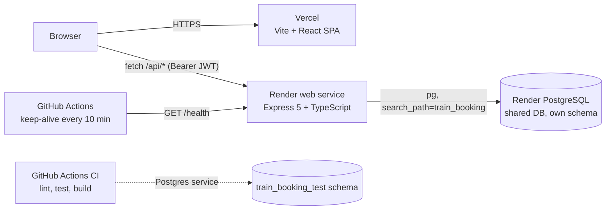

# RailDesk: Train Ticket Booking

[](https://github.com/HarshBathija-04/Train-Ticket-Booking/actions/workflows/ci.yml)

**Search Indian trains, pick your exact berth on a live coach map, and get a PNR in seconds, on a booking engine that cannot sell the same seat twice.**

| | |
| --- | --- |
| **Live demo** | `https://raildesk.vercel.app` _(placeholder: replace after the first Vercel deploy)_ |
| **API health** | `https://raildesk-api.onrender.com/health` _(placeholder: replace after the first Render deploy)_ |
| **Demo login** | `demo@raildesk.dev` / `Demo@1234` (the sign-in page can fill these in for you) |

> The API runs on Render's free tier and sleeps when idle. The first request can take 30 to 60 seconds; the UI shows a "waking up the server" banner while it does.

## Features

- **Station autocomplete:** an accessible WAI-ARIA combobox over 19 major stations (city, name or code).
- **Train search:** 30 real routes (Rajdhani, Shatabdi, Vande Bharat, Mail/Express) with overnight-arrival markers, per-class fares and live seats left, plus a date strip.
- **Seat selection:** coach maps for 1A, 2A, 3A, SL, CC and EC with berth types (LB/MB/UB/SL/SU, window/aisle), refreshed every 20 seconds.
- **Checkout:** up to 6 passengers per PNR, inline validation, simulated payment.
- **Ticket:** printable e-ticket with a 10-digit PNR, copy button and berth chart.
- **My bookings:** upcoming vs past/cancelled tabs; cancelling releases seats instantly.
- **Admin overview:** revenue, seats sold and the latest bookings for `ADMIN` users.

## Screenshots

| Search | Seat selection | Ticket |
| --- | --- | --- |
|  |  |  |
|  |  |  |

## Architecture



## Engineering highlights

- **Transaction-safe bookings.** `POST /api/bookings` locks the train/date/class inventory row with `SELECT ... FOR UPDATE`, assigns seats, decrements `available_seats` and inserts the booking in one transaction. A `CHECK (available_seats >= 0)` and a partial unique index on `(schedule_class_id, seat_no) WHERE NOT cancelled` back it up, so even a buggy code path cannot double-sell a berth. A test fires 30 parallel requests at an 18-berth coach and asserts exactly 18 succeed.
- **Schema-per-app database.** Several portfolio apps share one free Render PostgreSQL instance. Each app sets `DB_SCHEMA`; the pool pins `search_path` to it and migrations create it, so tables never collide. The schema name is validated as a plain identifier because it is interpolated into SQL.
- **Lazy daily schedules.** Trains run every day; a date's schedules and seat inventory are materialised on first search with `INSERT ... ON CONFLICT DO NOTHING`, so the demo never runs out of future dates.
- **Idempotent boot.** Render runs `migrate && seed && start` on every deploy. Migrations are tracked in `schema_migrations`; the seed upserts and tops the demo account up with an upcoming trip as old ones drift into the past.
- **Hardened API surface.** Zod validation on every input, Helmet headers, CORS allow-list, rate limits (stricter on auth), 20 KB body limit, HS256-pinned JWTs, and one JSON error shape (`{ "error": { "code", "message", "details" } }`). Other users' PNRs return 404, not 403, so they cannot be probed.
- **Cold-start aware UI.** The API client flags requests slower than 3.5 s and the layout shows a "waking up the server" banner; a GitHub Actions cron pings `/health` (which also runs `SELECT 1`) to keep the free tier warm.

## Tech stack

| Layer | Tech |
| --- | --- |
| Frontend | React 19, TypeScript, Vite 8, Tailwind CSS 4, TanStack Query, React Router 7, Sonner, Lucide |
| Backend | Node 22+, Express 5, TypeScript, `pg`, Zod, Helmet, express-rate-limit, bcryptjs, jsonwebtoken |
| Database | PostgreSQL (plain SQL migrations, idempotent seed) |
| Quality | Vitest, Supertest, ESLint, Prettier, GitHub Actions CI |
| Hosting | Vercel (frontend), Render web service + shared Render PostgreSQL |

## Quick start

Prerequisites: Node 22+ and a PostgreSQL database you can create a schema in.

```bash
# 1. API  ->  http://localhost:5130/health
cd backend
cp .env.example .env          # set DATABASE_URL (JWT_SECRET is optional locally)
npm install
npm run db:setup              # creates the schema, runs migrations, seeds demo data
npm run dev

# 2. Frontend (second terminal)  ->  http://localhost:5215
cd frontend
cp .env.example .env          # VITE_API_URL=http://localhost:5130
npm install
npm run dev
```

Sign in with the demo account above. Quality checks, run in both `backend/` and `frontend/`:

```bash
npm run lint && npm test && npm run build
```

Backend tests use the database in `DATABASE_URL` but drop and recreate their own `train_booking_test` schema.

## Environment variables

### Backend (`backend/.env`)

| Variable | Required | Default | Description |
| --- | --- | --- | --- |
| `DATABASE_URL` | yes | - | PostgreSQL connection string (Render: the shared DB's Internal Database URL) |
| `DB_SCHEMA` | no | `train_booking` | Postgres schema holding this app's tables (created automatically) |
| `JWT_SECRET` | in production | random per process in dev | Secret used to sign auth tokens |
| `FRONTEND_URL` | no | `http://localhost:5215` | Comma-separated list of origins allowed by CORS |
| `PORT` | no | `5130` | HTTP port (Render injects its own) |
| `NODE_ENV` | no | - | `production` on Render |
| `ADMIN_PASSWORD` | no | - | If set, the seed creates or updates `admin@raildesk.dev` with this password |

### Frontend (`frontend/.env`)

| Variable | Required | Description |
| --- | --- | --- |
| `VITE_API_URL` | yes (prod) | Base URL of the API, with no trailing slash, e.g. `https://raildesk-api.onrender.com` |

## Deployment

1. **Database (once, shared).** Create one free Render PostgreSQL instance for all portfolio apps. Copy its **Internal Database URL**.
2. **API on Render.** Dashboard → **New → Blueprint** → pick this repo. `render.yaml` declares `raildesk-api` (rootDir `backend`, health check `/health`, `DB_SCHEMA=train_booking`, generated `JWT_SECRET`). When prompted, set:
   - `DATABASE_URL`: the shared database's Internal Database URL
   - `FRONTEND_URL`: your Vercel URL, e.g. `https://raildesk.vercel.app` (comma-separate extra origins)
   - `ADMIN_PASSWORD` (optional): enables `admin@raildesk.dev`
3. **Frontend on Vercel.** **Add New Project** → import this repo → **Root Directory** `frontend` (Vite preset) → add `VITE_API_URL=https://<your-service>.onrender.com` → Deploy. `vercel.json` adds SPA rewrites plus cache and security headers.
4. **Keep-alive.** GitHub → **Settings → Secrets and variables → Actions → Variables** → add `BACKEND_URL=https://<your-service>.onrender.com`. The `Keep alive` workflow pings `/health` every 10 minutes and skips with a notice when the variable is unset.
5. Replace the placeholder links at the top of this README.

## API

| Method | Path | Auth | Description |
| --- | --- | --- | --- |
| GET | `/health` | - | Runs `SELECT 1`; returns `{"status":"ok","db":"ok"}`, or 503 |
| GET | `/api/stations?q=` | - | Station autocomplete |
| GET | `/api/trains/search?from=&to=&date=` | - | Trains and class availability for a date (today to +60 days) |
| GET | `/api/schedules/:id` | - | One train run with its classes |
| GET | `/api/schedules/:id/classes/:class/seats` | - | Seat map: total, available and booked seat numbers |
| POST | `/api/auth/register` · `/api/auth/login` | - | Returns `{ token, user }` (rate limited) |
| GET | `/api/auth/me` | user | Current user |
| POST | `/api/bookings` | user | Book `{ scheduleId, classCode, passengers[{name, age, gender, seatNo?}] }` |
| GET | `/api/bookings` · `/api/bookings/:pnr` | user | Own bookings / one ticket |
| POST | `/api/bookings/:pnr/cancel` | user | Cancel and release seats |
| GET | `/api/admin/overview` | admin | Stats and latest bookings |

Errors always use the same shape: `{ "error": { "code": "SEAT_TAKEN", "message": "...", "details": [...] } }`.

## Project structure

```
.
├── backend/                 Express + TypeScript API (Render)
│   ├── migrations/          Plain SQL migrations (001_init.sql)
│   ├── src/
│   │   ├── app.ts           Express app: helmet, CORS, rate limits, routes, errors
│   │   ├── server.ts        HTTP entry point
│   │   ├── config.ts        Env-only configuration
│   │   ├── db/              pg pool, migration runner, idempotent seed
│   │   ├── lib/             Seat assignment, PNRs, IST dates, HttpError
│   │   ├── middleware/      JWT auth
│   │   └── routes/          auth, trains (stations/search/seats), bookings, admin
│   └── test/                Vitest unit + Supertest API tests
├── frontend/                Vite + React + Tailwind SPA (Vercel)
│   ├── public/              favicon, Open Graph image
│   └── src/
│       ├── components/      Layout, StationInput, SearchForm, TrainCard, SeatMap, ...
│       ├── lib/             API client (cold-start detection), auth context, formatters
│       └── pages/           Home, Search, Book, BookingDetail, MyBookings, Auth, Admin
├── docs/screenshots/
├── render.yaml              Render Blueprint
└── .github/workflows/       ci.yml, keep-alive.yml
```

## Background

RailDesk began as a Java Servlet/JSP college project whose DAOs kept everything in in-memory lists. It was rebuilt as a typed JSON API and a React SPA; the original data model (users, trains, schedules, bookings) was ported to PostgreSQL and extended with stations, per-class inventory and passengers. The legacy code lives in git history.

## License

MIT
