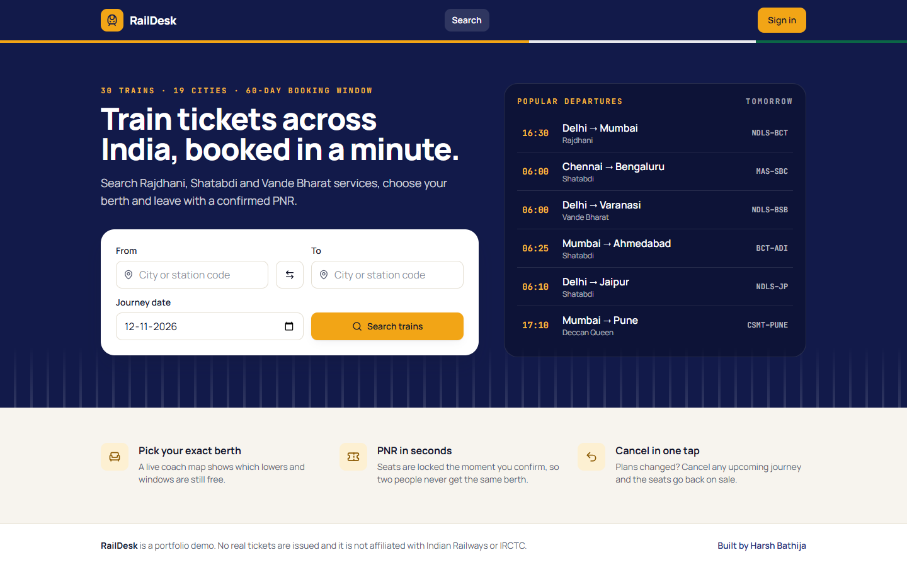
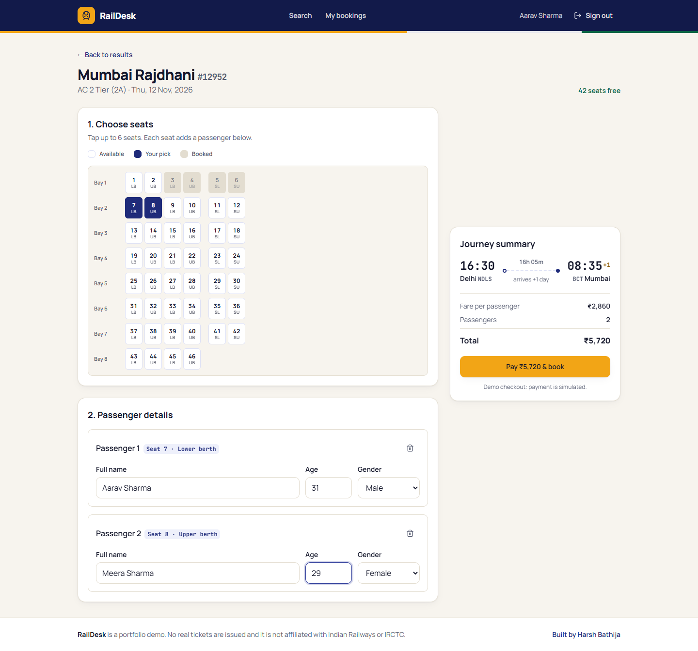
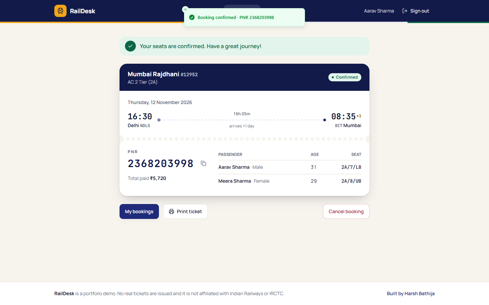
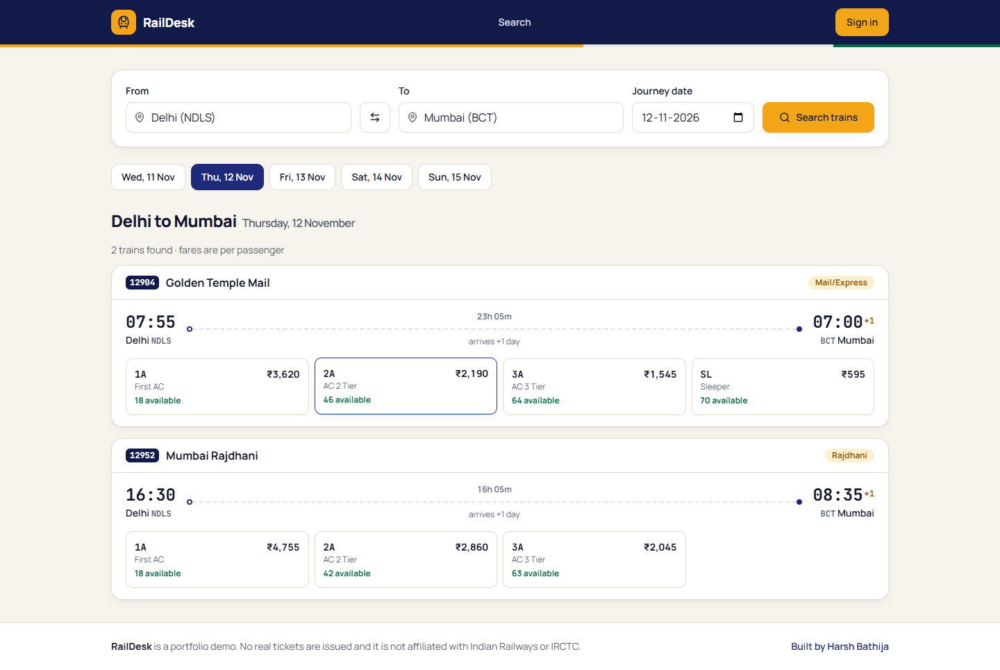
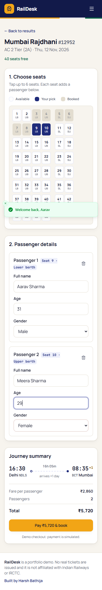
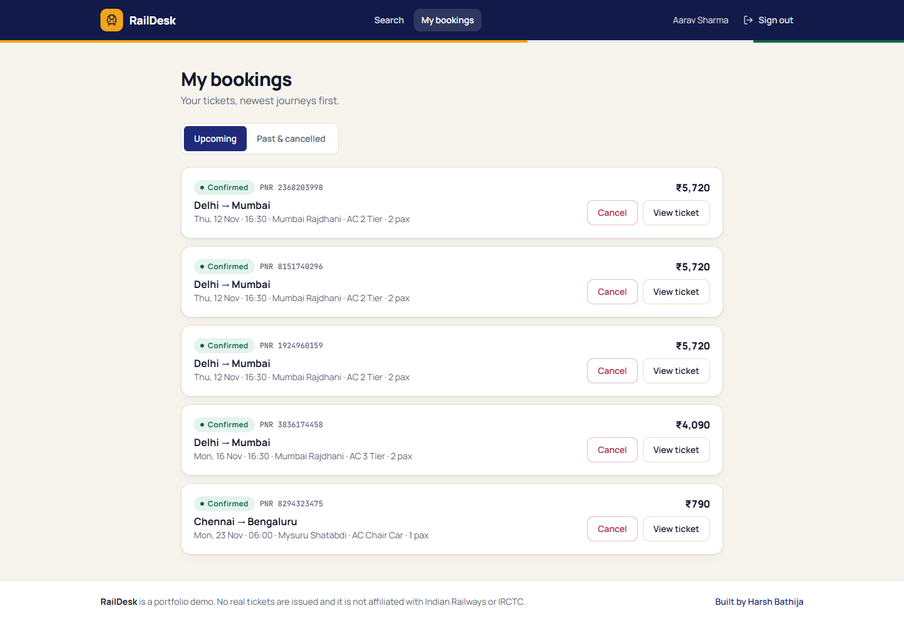
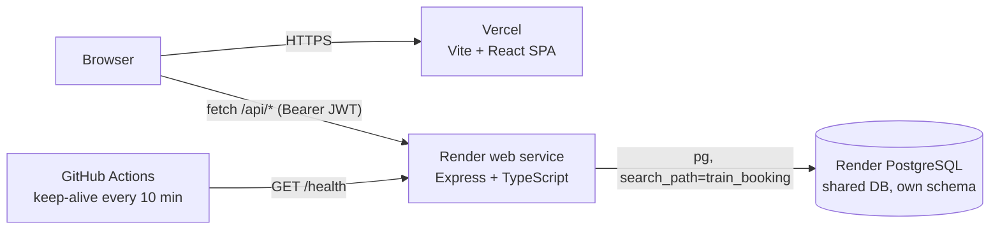

# RailDesk: Train Ticket Booking

Search trains between Indian cities, pick your exact berth on a live coach map, and get a PNR in seconds, with booking that cannot oversell a seat.

**Live demo:** [raildesk.vercel.app](https://raildesk.vercel.app) (frontend, Vercel) · [raildesk-api.onrender.com/health](https://raildesk-api.onrender.com/health) (API, Render)
_Placeholder URLs: replace them after the first deploy._

**Demo login:** `demo@raildesk.dev` / `Demo@1234` (the login page can also fill these in for you)

> The API runs on Render's free tier and sleeps when idle. The first request can take 30 to 60 seconds; the UI shows a "waking up the server" notice while that happens.

## Features

- **Station autocomplete:** an accessible combobox (keyboard, screen reader) that searches 19 major stations by city, name or code.
- **Train search:** 30 real-world routes (Rajdhani, Shatabdi, Vande Bharat, Mail/Express) with times, overnight arrival markers, duration, and fare and seats left for each class. A date strip lets you move between days.
- **Class and seat selection:** coach maps for 1A, 2A, 3A, SL, CC and EC show berth types (LB/MB/UB/SL/SU, window/aisle). Booked seats refresh every 20 seconds.
- **Passenger form:** up to 6 passengers per PNR, one per selected seat, with inline validation.
- **Booking confirmation:** a printable ticket with a 10-digit PNR, a copy button, a passenger and berth chart, and the total fare (payment is simulated).
- **My bookings:** upcoming and past/cancelled tabs. Cancelling an upcoming journey releases its seats immediately.
- **Admin overview:** revenue, seats sold, and the latest bookings, shown only to users with the `ADMIN` role.
- **Transaction-safe booking:** see [Overbooking protection](#overbooking-protection).

## Screenshots

| Search | Seat selection | Ticket |
| --- | --- | --- |
|  |  |  |
|  |  |  |

## Architecture



### Overbooking protection

`POST /api/bookings` runs in a single transaction:

1. `SELECT … FROM schedule_classes … FOR UPDATE` locks that train/date/class inventory row, so concurrent bookings of the same class are processed one after another.
2. Requested seats are checked against the active passengers. Seats left blank are auto-assigned to the lowest free numbers.
3. `available_seats` is decremented, then the booking and its passengers are inserted.

Two constraints back this up in the schema: `CHECK (available_seats >= 0)`, and a partial unique index on `(schedule_class_id, seat_no) WHERE NOT cancelled`. Even a buggy code path cannot sell the same berth twice. The test suite fires 30 parallel requests at an 18-berth First AC coach and asserts that exactly 18 succeed.

Trains run daily. Schedules and per-class inventory for a date are created on first search (`INSERT … ON CONFLICT DO NOTHING`), so the demo never runs out of future dates.

## Tech stack

| Layer | Tech |
| --- | --- |
| Frontend | React 19, TypeScript, Vite 8, Tailwind CSS 4, TanStack Query, React Router 7, Sonner, Lucide |
| Backend | Node 22+, Express 5, TypeScript, `pg`, Zod, Helmet, express-rate-limit, bcryptjs, JSON Web Tokens |
| Database | PostgreSQL (plain SQL migrations + idempotent seed) |
| Quality | Vitest + Supertest, ESLint, Prettier, GitHub Actions CI |
| Hosting | Vercel (frontend), Render web service + Render PostgreSQL (API, DB) |

## Local setup

Prerequisites: Node 22+ and a PostgreSQL database.

```bash
# 1. API
cd backend
cp .env.example .env          # set DATABASE_URL and JWT_SECRET
npm install
npm run db:setup              # creates the schema, runs migrations, seeds demo data
npm run dev                   # http://localhost:5130  (GET /health)

# 2. Frontend (new terminal)
cd frontend
cp .env.example .env          # VITE_API_URL=http://localhost:5130
npm install
npm run dev                   # http://localhost:5215
```

Quality checks (run in `backend/` and in `frontend/`):

```bash
npm run lint && npm test && npm run build
```

Backend tests run against the database in `DATABASE_URL`, in a throwaway schema named `train_booking_test`.

## Environment variables

### Backend (`backend/.env`)

| Variable | Required | Default | Description |
| --- | --- | --- | --- |
| `DATABASE_URL` | yes | - | PostgreSQL connection string (Render: the shared DB's Internal Database URL) |
| `DB_SCHEMA` | no | `train_booking` | Postgres schema holding this app's tables (created automatically) |
| `JWT_SECRET` | in production | random per process in dev | Secret used to sign auth tokens |
| `FRONTEND_URL` | no | `http://localhost:5215` | Comma-separated list of origins allowed by CORS |
| `PORT` | no | `5130` | HTTP port (Render injects its own) |
| `NODE_ENV` | no | - | `production` on Render |
| `ADMIN_PASSWORD` | no | - | If set, the seed creates or updates `admin@raildesk.dev` with this password |

### Frontend (`frontend/.env`)

| Variable | Required | Description |
| --- | --- | --- |
| `VITE_API_URL` | yes (prod) | Base URL of the API, with no trailing slash, e.g. `https://raildesk-api.onrender.com` |

## API

| Method | Path | Auth | Description |
| --- | --- | --- | --- |
| GET | `/health` | - | Runs `SELECT 1`; returns `{"status":"ok","db":"ok"}`, or 503 |
| GET | `/api/stations?q=` | - | Station autocomplete |
| GET | `/api/trains/search?from=&to=&date=` | - | Trains and class availability for a date (today to +60 days) |
| GET | `/api/schedules/:id` | - | One train run with its classes |
| GET | `/api/schedules/:id/classes/:class/seats` | - | Seat map: total, available and booked seat numbers |
| POST | `/api/auth/register` · `/api/auth/login` | - | Returns `{ token, user }` (rate limited) |
| GET | `/api/auth/me` | user | Current user |
| POST | `/api/bookings` | user | Book `{ scheduleId, classCode, passengers[{name, age, gender, seatNo?}] }` |
| GET | `/api/bookings` · `/api/bookings/:pnr` | user | Own bookings / one ticket |
| POST | `/api/bookings/:pnr/cancel` | user | Cancel and release seats |
| GET | `/api/admin/overview` | admin | Stats and latest bookings |

Errors always use the same shape: `{ "error": { "code": "SEAT_TAKEN", "message": "...", "details": [...] } }`.

## Deployment

### 1. Database (once, shared)

Create a single **Render PostgreSQL** instance on the free plan (one per account, shared by all portfolio apps). This app keeps its tables in its own schema (`DB_SCHEMA=train_booking`), so nothing collides.

### 2. API on Render

1. Render dashboard → **New → Blueprint** → select this repository. `render.yaml` declares `raildesk-api` (rootDir `backend`, health check `/health`, free plan).
2. When prompted, set:
   - `DATABASE_URL`: the shared database's **Internal Database URL**
   - `FRONTEND_URL`: your Vercel URL, e.g. `https://raildesk.vercel.app` (comma-separate extra origins such as preview URLs)
   - `ADMIN_PASSWORD` (optional): enables the admin login
   - `JWT_SECRET` is generated by Render.
3. Every start runs `migrate` and `seed`, both idempotent, then starts the server.

### 3. Frontend on Vercel

1. Vercel → **Add New Project** → import this repository → set **Root Directory** to `frontend` (framework preset: Vite).
2. Add the environment variable `VITE_API_URL=https://<your-render-service>.onrender.com`.
3. Deploy. `vercel.json` adds SPA rewrites and cache/security headers.

### 4. Keep-alive

GitHub → repository **Settings → Secrets and variables → Actions → Variables** → add `BACKEND_URL=https://<your-render-service>.onrender.com`. The `Keep alive` workflow pings `/health` every 10 minutes, which also exercises the DB connection. If the variable is unset, the workflow skips with a notice.

## Project structure

```
.
├── backend/                 Express + TypeScript API (Render)
│   ├── migrations/          Plain SQL migrations (001_init.sql)
│   ├── src/
│   │   ├── app.ts           Express app: helmet, CORS, rate limits, routes, errors
│   │   ├── server.ts        HTTP entry point
│   │   ├── config.ts        Env-only configuration
│   │   ├── db/              pg pool, migration runner, idempotent seed
│   │   ├── lib/             Seat assignment, PNRs, IST dates, HttpError
│   │   ├── middleware/      JWT auth
│   │   └── routes/          auth, trains (stations/search/seats), bookings, admin
│   └── test/                Vitest unit + Supertest API tests
├── frontend/                Vite + React + Tailwind SPA (Vercel)
│   ├── public/              favicon, Open Graph image
│   └── src/
│       ├── components/      Layout, StationInput, SearchForm, TrainCard, SeatMap, ...
│       ├── lib/             API client (cold-start detection), auth context, formatters
│       └── pages/           Home, Search, Book, BookingDetail, MyBookings, Auth, Admin
├── docs/screenshots/
├── render.yaml              Render Blueprint
└── .github/workflows/       ci.yml, keep-alive.yml
```

## History

This started as a Java Servlet/JSP college project (`BookTrainTickets/`) whose DAOs stored everything in in-memory lists, while a MySQL dump sat unused. It was rewritten as a typed JSON API plus a React SPA: Render has no native Java runtime, the servlets needed a Tomcat image and a build system the project never had, and almost every DAO would have needed rewriting anyway. The original data model (Users, Trains, Train_Schedules, Bookings) was ported to PostgreSQL and extended with stations, per-class inventory and passengers. The legacy code is still available in git history.

## License

MIT
